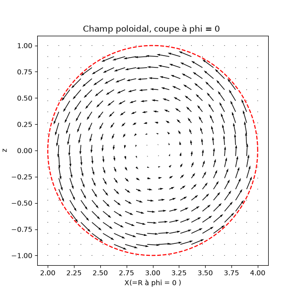
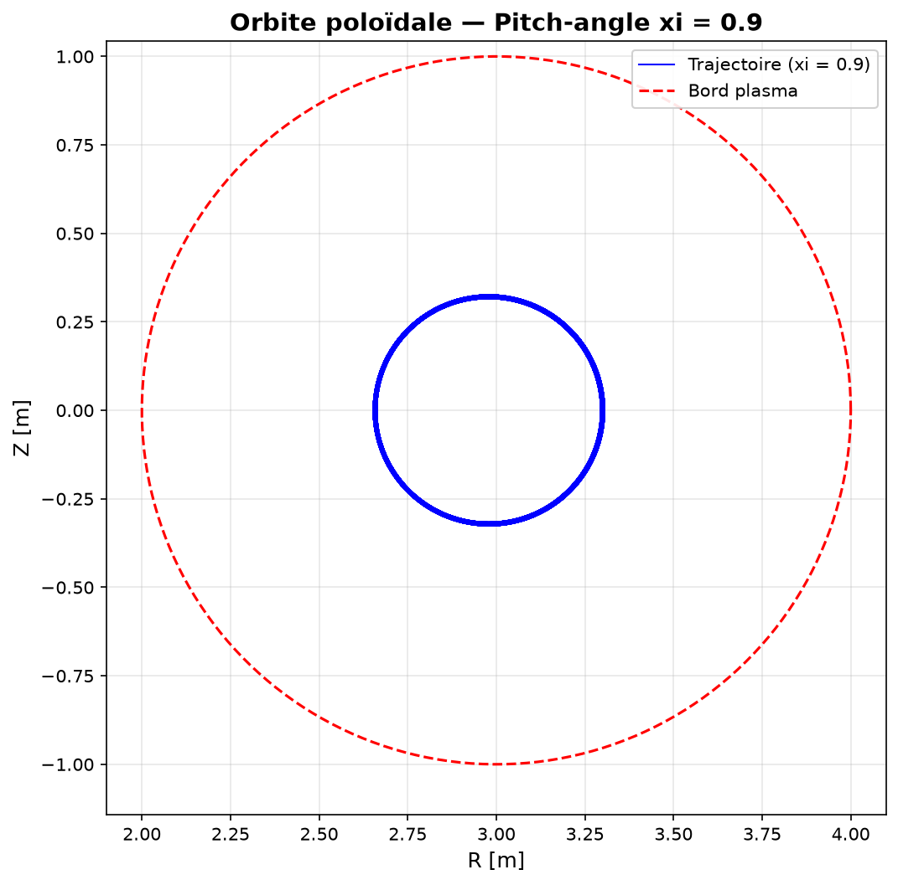
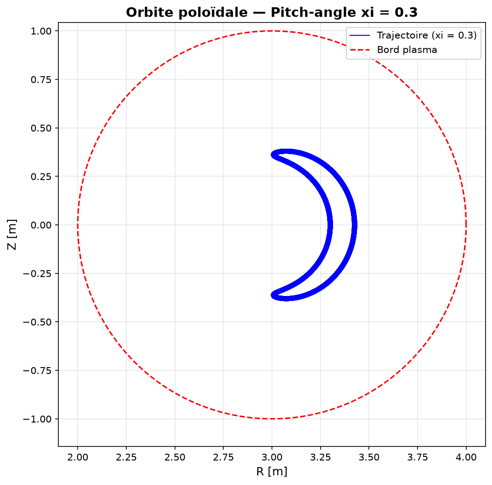
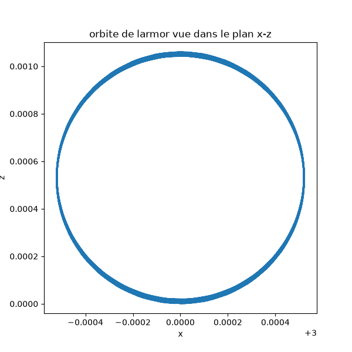
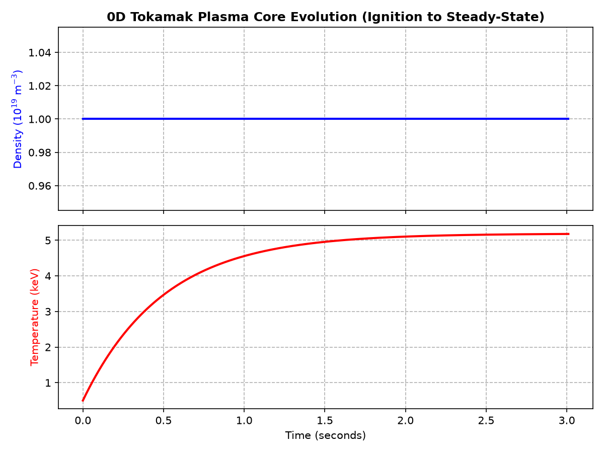

# 🌌 Tokamak Orbit Sim & Confinement Framework

**An advanced automated scientific computing framework exploring nuclear fusion through 3D charged-particle tracking and 0D plasma power-balance modeling.**

[](https://www.python.org/)
[](https://opensource.org/licenses/MIT)
[]()
[]()

---

## 🔬 Project Overview & Ambition

How can numerical modeling secure and optimize the future of clean energy? This repository bridges computational discipline and plasma mechanics by implementing a dual-module simulator inside a Tokamak geometry. 

Powered by a generic, physics-blind **4th-Order Runge-Kutta (RK4) integration engine**, the framework delivers two distinct levels of simulation:
1. **Microscopic Dynamics (3D):** Tracking charged-particle gyro-orbits under the Lorentz force, successfully resolving complex trajectories and spatial magnetic drifts.
2. **Macroscopic Energy (0D):** Solving the coupled non-linear equations of plasma transport, particle fueling, and radiation losses to analyze the **Lawson Criterion** and steady-state core ignition limits.

Built with strict software engineering paradigms, the entire infrastructure is cross-verified by an automated non-regression testing suite. This project represents a rigorous computing laboratory driven by an ambitious physics student eager to learn, excel, and contribute to the field of computational plasma physics and fusion research.

---

## 🎯 Core Project Objectives

*   **Generic Integration:** Build a reusable, modular RK4 ordinary differential equation (ODE) engine completely decoupled from specific physics.
*   **Geometric Modelling:** Simulate a non-uniform 3D helical magnetic field including toroidal 1/R decay and poloidal safety profiles.
*   **Dynamic Tracking:** Solve the 6D coupled equations of motion derived from the Lorentz force.
*   **Thermodynamic Balance:** Simulate the coupled time evolution of global plasma density and temperature.
*   **Automated Verification:** Establish a strict, automated non-regression testing suite using `pytest` to guarantee code immunity.
*   **Scientific Visualization:** Generate clear, reproducible plots to investigate how initial conditions affect particle confinement and power balance.

---

## 📊 Executive Simulation Results

The figures below are generated by the project's visualization workflows. They illustrate the critical kinetic and thermodynamic behaviors that dictate plasma stability in magnetic fusion devices.

### 1. The Poloidal Magnetic Field Topology
Before tracking dynamics, the geometric structure of the magnetic cage must be verified. The code successfully maps the nested magnetic cross-sections responsible for vertical particle confinement.


*Figure 1. Visualization of the simulated poloidal magnetic field lines wrapping around the core.*

### 2. The Passing Orbits (High Parallel Velocity: ξ = 0.9)
When a proton is launched with velocity dominant along the field lines, it travels continuously around the torus. However, the simulator automatically captures a beautiful, non-trivial plasma phenomenon: the **Shafranov Shift**. Because the field decreases toward the outside, the particle experiences a vertical gradient drift, shifting the entire circular orbit outward away from the geometric center.


*Figure 2. Clean, drift-shifted circular Passing Orbit demonstrating the Shafranov Shift.*

### 3. The Trapped Banana Orbits (High Perpendicular Velocity: ξ = 0.3)
When a particle has more side-to-side velocity, it encounters an invisible wall. As it flies toward the inner side of the donut where the magnetic field is strongest, the intense gradient acts as a **Magnetic Mirror**. The particle's parallel velocity drops to zero, and it is violently reflected backward. The combination of this bouncing motion and the vertical magnetic drift forces the particle to map out a magnificent macroscopic **Banana Orbit**.


*Figure 3. Complete, macroscopic Trapped Orbit exhibiting mirror reflection and banana closure.*

### 4. Microscopic Larmor Gyromotion
By zooming deeply into the particle trajectory, the simulator perfectly resolves the fundamental high-frequency spiral of the charge around the local magnetic field line, validating numerical stability at sub-millimeter scales.


*Figure 4. Microscopic Larmor gyromotion tracking the ultra-fine ribbon thickness of the trajectory.*

### 5. Macroscopic 0D Plasma Confinement & Power Balance
By activating the second physics module, the framework evaluates the global thermodynamic evolution of the plasma core. Under an auxiliary external heating power, the core temperature rises rapidly before bending into a perfect steady-state plateau at 5.18 keV. This saturation is caused by the non-linear scaling of Bremsstrahlung radiation losses and thermal transport leakage across the magnetic cage, allowing for direct evaluation of the Lawson Criterion.


*Figure 5. Time evolution and steady-state thermal stabilization of the tokamak plasma core.*

---

## ⚛️ Physical Models & Governing Principles

### The 3D Particle Module
The spatial and velocity evolution of a non-relativistic charged particle is governed by the 3D **Lorentz Force Law**:
*   *Concept:* Force = mass * acceleration = charge * (velocity vector x Magnetic Field vector)

The simulation groups these properties into a single **6D State Vector** combining 3D Cartesian positions and 3D velocity components. The magnetic field alters the particle's direction vector while strictly conserving its total kinetic energy.

To stabilize the plasma, the simulator overlays two perpendicular magnetic configurations:
1.  **Toroidal Field (B_phi):** Flows horizontally around the large ring. It follows a strict geometric 1/R decay law, growing weaker as the major radius R increases.
2.  **Poloidal Field (B_theta):** Wraps vertically around the core and depends on the **Safety Factor (q)**, which governs the pitch of the lines.

### The 0D Confinement Module
This module scales up to look at the macro-scale plasma box. The variation of density (n) and temperature (T) over time is governed by particle conservation and a rigorous power-balance equation:
*   **Particle Fueling:** Controlled by a strict source rate versus transport particle loss (n / tau_p), defining the average particle lifespan.
*   **Power Balance:** Computed as Net Power = External Heating (NBI/Microwaves) - Radiation Losses (Bremsstrahlung braking radiation) - Transport Thermal Leakage.
*   **The Lawson Criterion:** Evaluated using the steady-state triple product (n * T * tau_E) to measure how close the simulated reactor core comes to thermonuclear ignition conditions.

---

## 🧮 Numerical Method: Generic 4th-Order Runge-Kutta

All differential equations are integrated using a custom, explicit **Fourth-Order Runge-Kutta (RK4)** scheme. 

For any state vector equation *dy/dt = f(t, y)*, the step advances the state by taking a weighted average of four intermediate slopes evaluated across the time step intervals. 

Crucially, the integrator is written to be **completely physics-blind**. It knows nothing about tokamaks, pendulums, or protons, making it a highly modular math engine that can be seamlessly reused for entirely different systems of differential equations.

---

## 🧪 Verification Framework & Software Rigor

In scientific computing, we should never trust a simulation we haven't programmatically verified. This project implements an automated unit-testing pipeline using `pytest` to guarantee mathematical and physical soundness.

### 7 Automated Tests Across 5 Safety Barriers:
*   **`test_integrators.py`**: Validates the mathematical precision of the generic RK4 algorithm against a reference exponential decay model whose exact analytical solution is known, isolating the math engine from the physics.
*   **`test_pendule.py`**: Verifies the linear integration stability of the RK4 scheme under small mechanical oscillations, validating numerical accuracy against a pure analytical cosinusoidal solution.
*   **`test_fields.py`**: Programmatically asserts the geometric integrity of the magnetic field model, verifying symmetries and the strict 1/R decay factor across multiple coordinates.
*   **`test_particle.py`**: Executes a quantitative physical benchmark. It simulates a full micro-gyro-orbit and compares the observed numerical displacement against the theoretical analytical **Larmor Radius** formula under rigid tolerance thresholds.
*   **`test_confinement.py`**: Asserts the mathematical and physical convergence of the coupled 0D non-linear ODE balance equations, ensuring the steady-state core bounds tightly to theoretical fusion ignition regimes around 5.18 keV.

---

## 🛠️ Technologies & Dependencies

This project is built using a standard, high-performance scientific Python stack:

*   **Python 3.10+**: Core programming language.
*   **NumPy**: Utilized for fast, vectorized numerical operations (array manipulations, cross products, and 3D trajectory storage).
*   **Matplotlib**: Used for generating the executive-grade scientific visualizations and trajectory plots.
*   **Pytest**: The standard testing framework ensuring mathematical and physical non-regression.

---

## 🏗️ Project Structure

```text
tokamak-orbit-sim/
├── src/
│   └── tokamaksim/
│       ├── __init__.py
│       ├── integrators.py       # Generic RK4 time-step solver
│       ├── fields.py            # Analytical helical magnetic field equations
│       ├── particle.py          # 6D Lorentz force state derivatives
│       └── confinement.py       # 0D plasma power-balance equations
├── tests/
│   ├── test_confinement.py      # Automated 0D convergence tests
│   ├── test_fields.py           # Automated field verification tests
│   ├── test_integrators.py      # Automated mathematical accuracy tests
│   ├── test_particle.py         # Automated quantitative Larmor physics tests
│   └── test_pendule.py          # Automated linear pendulum validation tests
├── scripts/                     # Exploratory research & diagnostic plotting scripts
│   ├── Champ_poloidal.png
│   ├── orbit_xi_0.3.png
│   ├── orbit_xi_0.9.png
│   ├── orbite_larmor.png
│   ├── plasma_0d_evolution.png
│   ├── diagnosis_confinement.py # Lawson triple product reporting script
│   ├── simulate_banana.py
│   ├── visualize_Larmor.py
│   ├── visualize_field.py
│   └── visualize_orbit.py
├── README.md
└── requirements.txt


